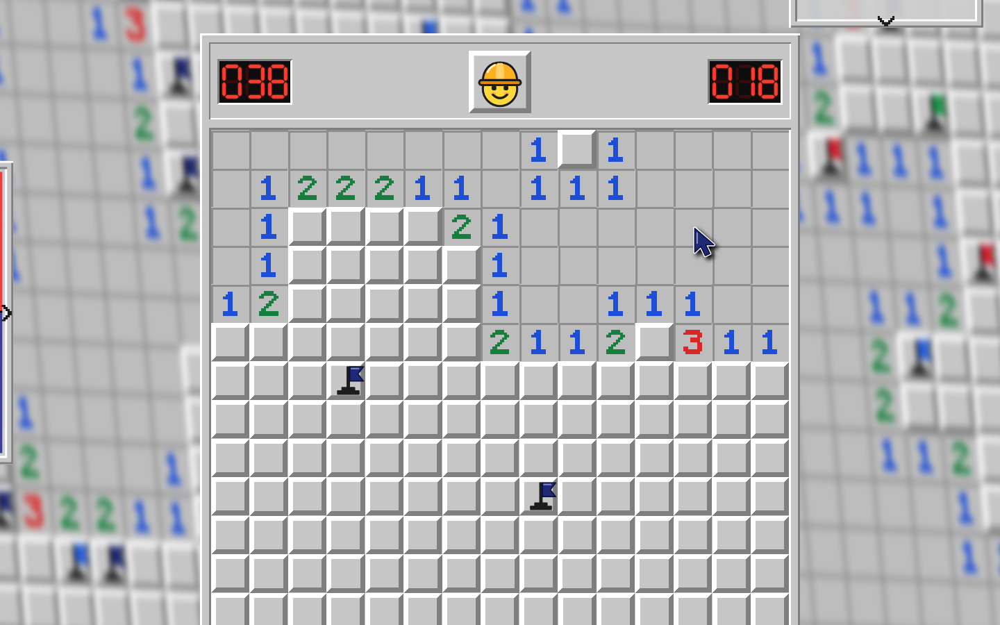
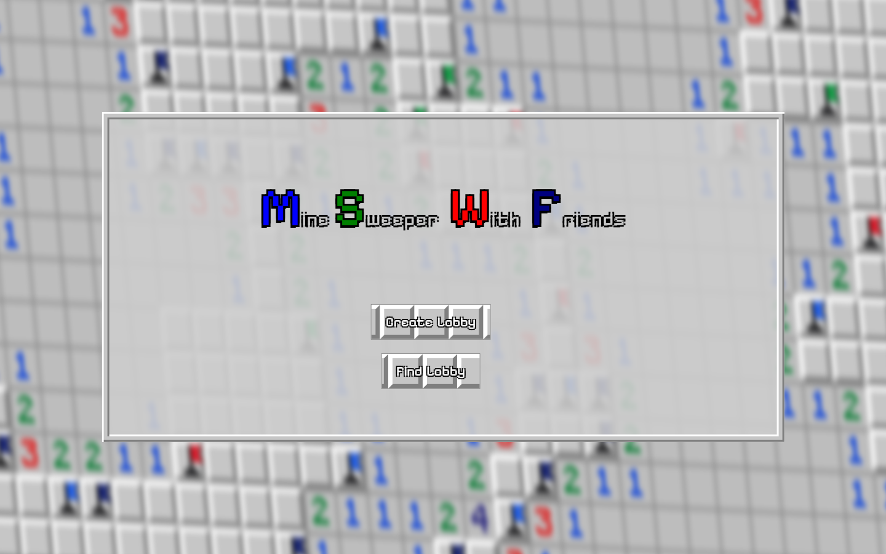
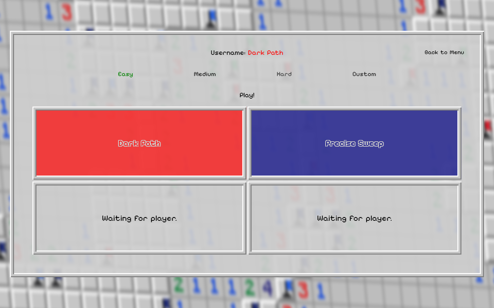
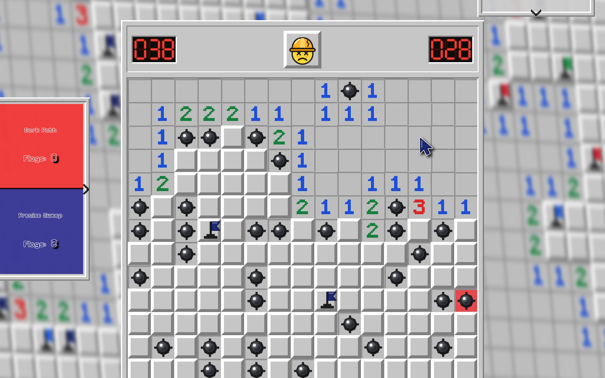
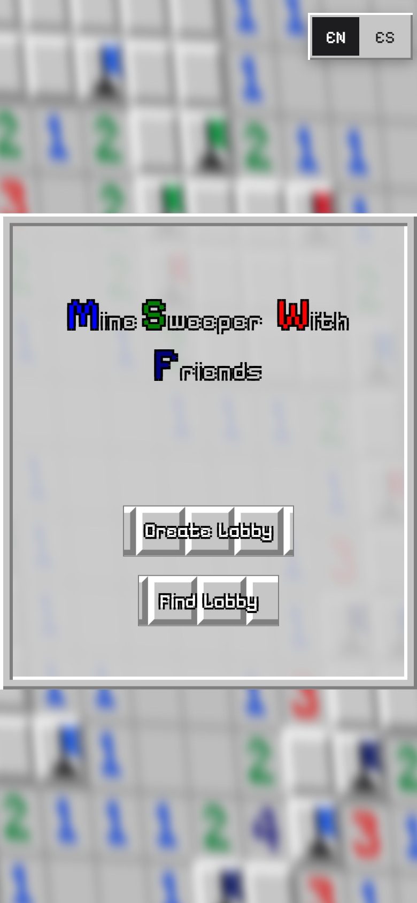
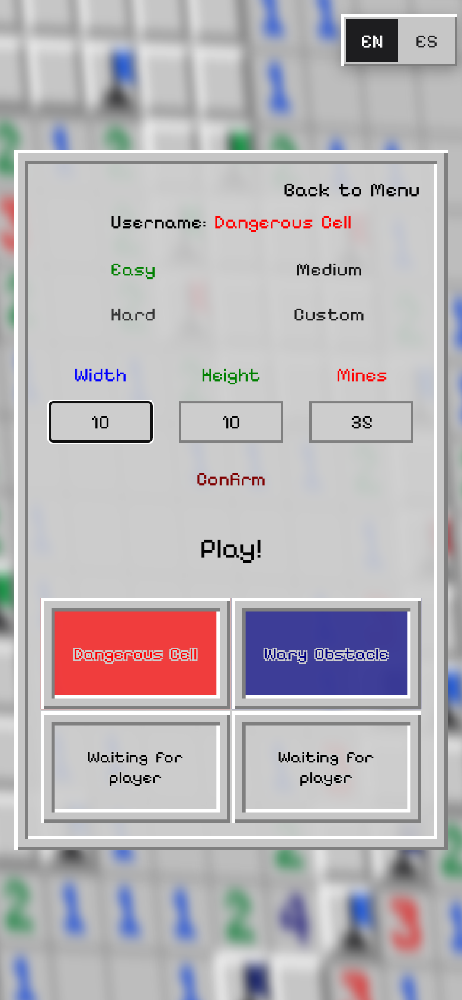
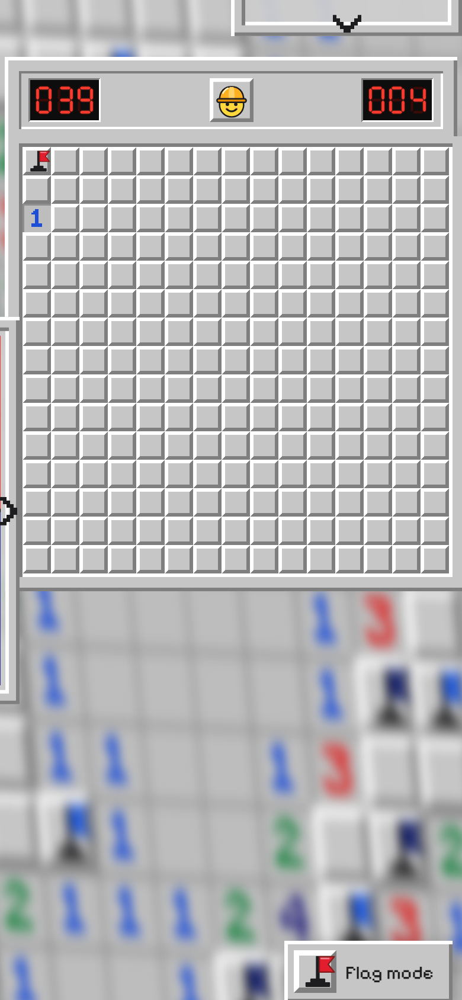
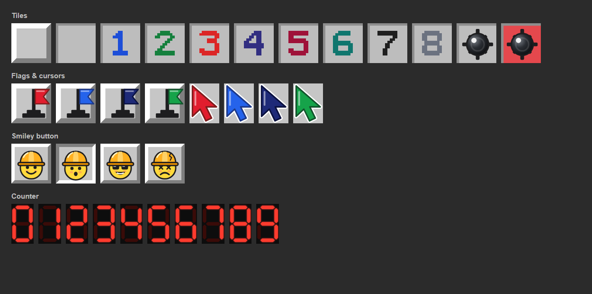

# Minesweeper With Friends

Real-time co-op Minesweeper for up to four players, right in the browser. Create a lobby, share it with friends, and clear the board together. Everyone sees each other's cursors and flags live.

**Play it:** [ms.juancarloscj.com](https://ms.juancarloscj.com)



## Features

- **Lobbies for up to 4 players.** Create one or join from the lobby browser. Each player gets a random name and a colour.
- **Live co-op board.** Every reveal, flag and win or loss reaches all players instantly over WebSockets.
- **Shared cursors.** See where your friends are pointing.
- **Personal flags.** Flags show their owner's colour, only the owner can remove them, and the scoreboard counts each player's flags.
- **Plays on phones and tablets.** Touch controls, a board that sizes itself to the screen, and layouts for phones, tablets and landscape.
- **English and Spanish.** Picked automatically from the browser, switchable at any time, and remembered.
- **Four difficulties:** Easy (15×15, 40 mines), Medium (29×20, 135), Hard (29×29, 200) and Custom (up to 100×100).
- **Server-authoritative.** The board only exists on the server; clients receive just the cells that get revealed, so nobody can peek at the mines.
- **Original pixel-art look.** Every graphic is drawn from code (see [Artwork](#artwork)).

| Main menu | Lobby | Game over |
|---|---|---|
|  |  |  |

## Controls

| | Mouse | Touch screen |
|---|---|---|
| Reveal a cell | Left-click | Tap |
| Place / remove your flag | Right-click | Long-press (or turn on **Flag mode** and tap) |
| Open everything around a number (*chord*) | Click the number once its flags are placed | Tap the number once its flags are placed |
| Restart | Click the smiley | Tap the smiley |
| Zoom, back to menu | Hover the panel in the top-right corner | Tap the panel in the top-right corner |
| Scoreboard | Hover the panel on the left | Tap the panel on the left |

Big boards scroll on small screens; the counters and the smiley stay in view.

| Phone: menu | Phone: lobby | Phone: game |
|---|---|---|
|  |  |  |

## How it works

```
Browser (public/)                               Node.js server (server/)
─────────────────                               ────────────────────────
main.js    wires messages and buttons    ◄──►   index.js     Express + WebSocket on one port
socket.js  WebSocket client                 WS   players.js   connected players, names, colours
board.js   cells, sizing, mouse + touch input    game/lobbies.js  lobbies and game flow
lobby.js   lobby and lobby browser               game/board.js    mines, flood fill, win check
i18n.js    English / Spanish texts                protocol.js  message codes
```

- One HTTP server serves the page and the WebSocket on the same address. The client connects back to whatever host it was loaded from (`wss://` on HTTPS), so the same code runs locally and behind a hosting proxy.
- Messages are small JSON objects like `{ "action": "CD", "content": { "cellX": 3, "cellY": 7 } }`. Every code is listed and explained in [`server/protocol.js`](server/protocol.js).
- The server checks everything it receives: coordinates, custom board limits, flag ownership, and who is allowed to start a game.
- Dead connections are dropped with a ping/pong heartbeat.

## Run it locally

Requires [Node.js](https://nodejs.org) 18 or newer.

```bash
git clone https://github.com/JuanCarlosCJ/minesweeper-with-friends.git
cd minesweeper-with-friends
npm install
npm start
```

Open http://localhost:3000. To play with yourself, open a second browser window: create a lobby in one and join it from the other.

| Command | What it does |
|---|---|
| `npm start` | Starts the server (port `3000`, or `PORT` if set) |
| `npm run dev` | Same, restarting automatically when server files change |
| `npm test` | Runs the board rule tests |
| `npm run art` | Regenerates all graphics in `public/img/` (needs Python 3) |

## Project structure

```
server/            Node.js game server
  index.js         entry point: web server, WebSocket, message routing
  config.js        difficulties, limits, colours, port
  protocol.js      message codes (client ↔ server)
  players.js       connected players
  names.js         random player names
  game/board.js    board rules
  game/lobbies.js  lobbies and game flow
public/            the browser client (no build step)
  index.html
  css/style.css
  js/              ES modules
  img/             generated SVG graphics
  fonts/           Pixelify Sans (SIL Open Font License)
test/              Node test runner tests
tools/             graphics generator
docs/              screenshots
```

## Deployment

The server is a plain Node.js app that listens on `PORT`. A typical production setup is a process manager to keep it running, plus a web server in front of it for HTTPS:

1. Upload the project and install dependencies: `npm ci --omit=dev`.
2. Run it with [pm2](https://pm2.keymetrics.io/), which restarts it if it crashes and starts it at boot:

   ```bash
   PORT=3101 pm2 start server/index.js --name minesweeper
   pm2 save
   pm2 startup
   ```

3. Put a reverse proxy in front of it that also forwards WebSocket upgrades. For nginx:

   ```nginx
   location / {
       proxy_pass http://127.0.0.1:3101;
       proxy_http_version 1.1;
       proxy_set_header Upgrade $http_upgrade;
       proxy_set_header Connection "upgrade";
       proxy_set_header Host $host;
   }
   ```

The proxy handles HTTPS and certificate renewals, so the game itself never deals with certificates.

## Artwork

All graphics (tiles, numbers, mines, flags, cursors, the hard-hat smiley and the counter digits) are original and generated by [`tools/generate-art.py`](tools/generate-art.py). Colours and pixel maps sit at the top of that file. Change them and run `npm run art`.



The font is [Pixelify Sans](https://github.com/eifetx/Pixelify-Sans), used under the SIL Open Font License ([`public/fonts/OFL.txt`](public/fonts/OFL.txt)).

## License

[MIT](LICENSE) © Juan Carlos
